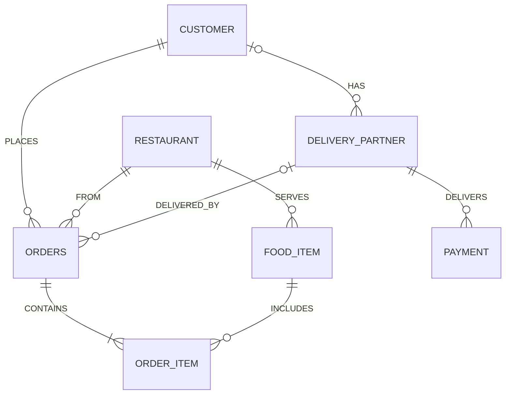

# Food Delivery Order Management System — Complete MySQL Guide (From Scratch)

> This guide explains the whole project **step by step**, assuming you are a **MySQL fresher**.
> Read it top to bottom once. Before the exam, revise **Section 14 (Viva Questions)** and **Section 15 (Cheat Sheet)**.

---

## Table of Contents

1. [What is this project?](#1-what-is-this-project)
2. [Basic database concepts](#2-basic-database-concepts)
3. [Understanding the ER Diagram](#3-understanding-the-er-diagram)
4. [The 7 entities (tables) explained](#4-the-7-entities-tables-explained)
5. [Data types used](#5-data-types-used)
6. [Keys and constraints](#6-keys-and-constraints)
7. [All relationships explained one by one](#7-all-relationships-explained-one-by-one)
8. [ON DELETE / ON UPDATE rules](#8-on-delete--on-update-rules)
9. [Walking through the SQL file](#9-walking-through-the-sql-file)
10. [The sample data — the story of each order](#10-the-sample-data--the-story-of-each-order)
11. [The 7 sample queries explained](#11-the-7-sample-queries-explained)
12. [Normalization in this project](#12-normalization-in-this-project)
13. [Types of SQL commands used](#13-types-of-sql-commands-used)
14. [Viva / exam questions with answers](#14-viva--exam-questions-with-answers)
15. [Cheat sheet](#15-cheat-sheet)

---

## 1. What is this project?

Think of apps like **Swiggy** or **Zomato**. When you order food:

1. A **customer** opens the app.
2. They pick a **restaurant**.
3. They add **food items** to the cart (e.g. 2 Butter Naan, 1 Paneer Butter Masala).
4. They place an **order**.
5. A **delivery partner** picks it up and delivers it.
6. A **payment** is made (UPI, Cash, Card…).

All this information must be **stored somewhere safely** so it can be searched later
("show me all orders of Aarav", "how much did Spice Garden earn?").
That "somewhere" is a **database**, and this project designs that database in **MySQL**.

**Project files:**

| File | What it contains |
|---|---|
| `food_delivery_system.sql` | The full MySQL code: creates the database, 7 tables, sample data, and 7 example queries |
| `PROJECT_EXPLANATION.md` | This guide |

**One-line answer for the teacher:**
> "My project is a relational database for a food delivery system. It has 7 tables — Customer, Restaurant, Delivery_Partner, Food_Item, Orders, Order_Item and Payment — designed from an ER diagram, connected using primary and foreign keys, and protected with constraints like NOT NULL, UNIQUE, CHECK and DEFAULT."

---

## 2. Basic database concepts

| Term | Simple meaning | Example in this project |
|---|---|---|
| **Data** | Raw facts | `"Aarav Sharma"`, `250.00`, `"UPI"` |
| **Database** | An organised collection of related data | `food_delivery_db` |
| **DBMS** | Software that manages a database | MySQL |
| **RDBMS** | A DBMS that stores data in **tables** connected by **relationships** | MySQL is an RDBMS |
| **SQL** | *Structured Query Language* — the language used to talk to the database | `SELECT * FROM Customer;` |
| **Table** (Relation) | Data arranged in rows and columns, like an Excel sheet | `Customer` table |
| **Row** (Record / Tuple) | One single entry in a table | One customer: Aarav Sharma |
| **Column** (Field / Attribute) | One property that every row has | `Email`, `Phone_No` |
| **Schema** | The structure/design of the database (tables, columns, keys) | The `CREATE TABLE` statements |

**Example — the `Customer` table looks like this:**

| Customer_ID | Full_Name | Email | Phone_No | Address |
|---|---|---|---|---|
| 1 | Aarav Sharma | aarav.sharma@example.com | 9876543210 | 12 MG Road, Pune |
| 2 | Priya Patel | priya.patel@example.com | 9876543211 | 45 FC Road, Pune |

- Each **row** = one customer.
- Each **column** = one piece of information about the customer.

---

## 3. Understanding the ER Diagram

**ER Diagram = Entity–Relationship Diagram.** It is the *drawing/plan* of the database, made **before** writing SQL. Just like an architect draws a house plan before building it.

### 3.1 Symbols in the diagram

| Symbol | Name | Meaning | Example |
|---|---|---|---|
| ▭ Rectangle | **Entity** | A real-world "thing" we store data about → becomes a **table** | CUSTOMER, ORDER |
| ⬭ Oval | **Attribute** | A property of an entity → becomes a **column** | Full_Name, Email |
| ⬭ Oval with **underlined** text | **Key attribute** | Uniquely identifies each row → becomes the **Primary Key** | <u>Customer_ID</u> |
| ◇ Diamond | **Relationship** | How two entities are connected | PLACES, CONTAINS |
| `1`, `N` on lines | **Cardinality** | *How many* of one entity relate to the other | Customer 1 — N Order |

### 3.2 Cardinality (very important!)

Cardinality tells **how many rows of one table can be linked to how many rows of another**.

| Type | Meaning | Real example |
|---|---|---|
| **1 : 1** (One-to-One) | One A has exactly one B | One person ↔ one Aadhaar number |
| **1 : N** (One-to-Many) | One A has many B, but each B belongs to only one A | One customer → many orders |
| **M : N** (Many-to-Many) | Many A relate to many B | Many orders ↔ many food items |

**Golden rule for converting 1 : N into tables:**
> The **Primary Key of the "1" side** is copied into the **"N" side** as a **Foreign Key**.

Example: Customer (1) — PLACES — (N) Order → `Customer_ID` is put inside the `Orders` table.

### 3.3 The full picture of our diagram (simplified)

```
   CUSTOMER ──1──< PLACES >──N── ORDER ──N──< FROM >──1── RESTAURANT
      │1                        │1   │N                       │1
      │                         │    │                        │
   < HAS >                 <CONTAINS> └──< DELIVERED_BY >     │ (Restaurant_ID FK)
      │N                        │N              │1          │N
      │                         │               │           │
   DELIVERY_PARTNER ◄───────────┼───────────────┘       FOOD_ITEM
      │1                   ORDER_ITEM ──N──< INCLUDES >──1──┘
      │
   < DELIVERS >
      │N
   PAYMENT
```

Read it as plain sentences:

- A **customer** PLACES many **orders**.
- Many **orders** come FROM one **restaurant**.
- One **delivery partner** DELIVERS many **orders** (DELIVERED_BY).
- One **order** CONTAINS many **order items**.
- Many **order items** INCLUDE one **food item**.
- One **restaurant** has many **food items** (Restaurant_ID FK).
- One **customer** HAS many **delivery partners**.
- One **delivery partner** DELIVERS many **payments**.

### 3.4 Mermaid version (renders as a picture on GitHub / VS Code with a Mermaid extension)



---

## 4. The 7 entities (tables) explained

> **PK** = Primary Key, **FK** = Foreign Key.
> Columns marked "(FK, added)" are **not drawn as ovals** in the diagram — they are created *because of a relationship* (the golden rule from 3.2).

### 4.1 `Customer` — people who order food

| Column | Type | Rules | Meaning |
|---|---|---|---|
| Customer_ID | INT | **PK**, AUTO_INCREMENT | Unique number for every customer (1, 2, 3…) |
| Full_Name | VARCHAR(100) | NOT NULL | Customer's name |
| Email | VARCHAR(100) | NOT NULL, UNIQUE | Two customers can't share an email |
| Phone_No | VARCHAR(15) | NOT NULL, UNIQUE | Two customers can't share a phone number |
| Address | VARCHAR(255) | NOT NULL | Delivery address |

> **Why is Phone_No `VARCHAR` and not `INT`?** We never do maths on phone numbers, they can start with `0` or `+91`, and a 10-digit number is too big for `INT` (max ≈ 2.1 billion). So text is the correct choice.

### 4.2 `Restaurant` — places that cook the food

| Column | Type | Rules | Meaning |
|---|---|---|---|
| Restaurant_ID | INT | **PK**, AUTO_INCREMENT | Unique restaurant number |
| Restaurant_Name | VARCHAR(100) | NOT NULL | e.g. "Spice Garden" |
| Cuisine_Type | VARCHAR(50) | NOT NULL | e.g. "North Indian", "Chinese" |
| Rating | DECIMAL(2,1) | DEFAULT 0.0, CHECK 0–5 | e.g. 4.5 |
| Address | VARCHAR(255) | NOT NULL | Restaurant location |
| Phone_No | VARCHAR(15) | NOT NULL, UNIQUE | Contact number |

### 4.3 `Delivery_Partner` — riders who deliver orders

| Column | Type | Rules | Meaning |
|---|---|---|---|
| Partner_ID | INT | **PK**, AUTO_INCREMENT | Unique rider number |
| Full_Name | VARCHAR(100) | NOT NULL | Rider's name |
| Phone_No | VARCHAR(15) | NOT NULL, UNIQUE | Rider's phone |
| Email | VARCHAR(100) | NOT NULL, UNIQUE | Rider's email |
| Vehicle_No | VARCHAR(20) | NOT NULL, UNIQUE | e.g. "MH12AB1234" — no two bikes share a number |
| Customer_ID | INT | **FK (added)** → Customer, NULL allowed | From the **HAS** relationship |

### 4.4 `Food_Item` — the menu

| Column | Type | Rules | Meaning |
|---|---|---|---|
| Food_ID | INT | **PK**, AUTO_INCREMENT | Unique dish number |
| Food_Name | VARCHAR(100) | NOT NULL | e.g. "Masala Dosa" |
| Category | VARCHAR(50) | NOT NULL | e.g. "Starter", "Main Course", "Beverage" |
| Price | DECIMAL(10,2) | NOT NULL, CHECK > 0 | Current menu price |
| Description | VARCHAR(255) | can be empty | Short description |
| Restaurant_ID | INT | **FK** → Restaurant, NOT NULL | Which restaurant serves this dish (shown as "Restaurant_ID (FK)" in the diagram) |

### 4.5 `Orders` — every order placed

> In the diagram this entity is called **ORDER**. But `ORDER` is a **reserved keyword** in SQL (used in `ORDER BY`), so we named the table **`Orders`** to avoid errors.

| Column | Type | Rules | Meaning |
|---|---|---|---|
| Order_ID | INT | **PK**, AUTO_INCREMENT | Unique order number |
| Order_Date | DATETIME | NOT NULL, DEFAULT current time | When the order was placed |
| Total_Amount | DECIMAL(10,2) | NOT NULL, DEFAULT 0, CHECK ≥ 0 | Full bill amount |
| Status | VARCHAR(20) | DEFAULT 'Placed', CHECK in a fixed list | Placed / Confirmed / Preparing / Out for Delivery / Delivered / Cancelled |
| Customer_ID | INT | **FK (added)** → Customer, NOT NULL | Who placed it (**PLACES**) |
| Restaurant_ID | INT | **FK (added)** → Restaurant, NOT NULL | Which restaurant it's from (**FROM**) |
| Partner_ID | INT | **FK (added)** → Delivery_Partner, NULL allowed | Who delivers it (**DELIVERED_BY**). NULL until a rider is assigned |

### 4.6 `Order_Item` — the lines inside an order (the "cart")

| Column | Type | Rules | Meaning |
|---|---|---|---|
| OrderItem_ID | INT | **PK**, AUTO_INCREMENT | Unique line number |
| Quantity | INT | NOT NULL, CHECK > 0 | How many pieces |
| Unit_Price | DECIMAL(10,2) | NOT NULL, CHECK > 0 | Price of one piece **at the time of ordering** |
| Total_Price | DECIMAL(10,2) | **Generated** = Quantity × Unit_Price | Calculated automatically by MySQL |
| Order_ID | INT | **FK (added)** → Orders | Which order this line belongs to (**CONTAINS**) |
| Food_ID | INT | **FK (added)** → Food_Item | Which dish (**INCLUDES**) |

> **Why store `Unit_Price` again if `Food_Item` already has `Price`?**
> Because menu prices change! If Paneer costs ₹250 today and ₹280 next month, old bills must still show ₹250. So we save the price *at the moment of ordering*.

### 4.7 `Payment` — money transactions

| Column | Type | Rules | Meaning |
|---|---|---|---|
| Payment_ID | INT | **PK**, AUTO_INCREMENT | Unique payment number |
| Amount | DECIMAL(10,2) | NOT NULL, CHECK > 0 | Money paid |
| Payment_Method | VARCHAR(20) | CHECK in ('Cash','Card','UPI','Net Banking','Wallet') | How it was paid |
| Payment_Date | DATETIME | DEFAULT current time | When it was paid |
| Payment_Status | VARCHAR(20) | DEFAULT 'Pending', CHECK in ('Pending','Completed','Failed','Refunded') | Payment state |
| Partner_ID | INT | **FK (added)** → Delivery_Partner, NOT NULL | From the **DELIVERS** relationship |

---

## 5. Data types used

| Data type | What it stores | Used for | Example |
|---|---|---|---|
| `INT` | Whole numbers | IDs, Quantity | `1`, `25` |
| `VARCHAR(n)` | Text up to *n* characters (uses only the space needed) | Names, emails, phone numbers | `VARCHAR(100)` → max 100 chars |
| `DECIMAL(p,s)` | Exact numbers with decimals. *p* = total digits, *s* = digits after the point | Money, rating | `DECIMAL(10,2)` → up to `99999999.99`; `DECIMAL(2,1)` → up to `9.9` |
| `DATETIME` | Date + time | Order_Date, Payment_Date | `'2026-10-20 12:30:00'` |

> **Why `DECIMAL` for money and not `FLOAT`?** `FLOAT` is approximate (0.1 + 0.2 may become 0.30000000000000004). Money must be **exact**, so we use `DECIMAL`.

> **`CHAR` vs `VARCHAR`:** `CHAR(10)` always uses 10 characters (pads with spaces). `VARCHAR(10)` uses only what is needed. Names vary in length, so `VARCHAR` is better.

---

## 6. Keys and constraints

**Constraints = rules that the database enforces automatically**, so wrong data can't get in. This keeps the data **accurate** (this is called **data integrity**).

### 6.1 Primary Key (PK)

- Uniquely identifies **each row**.
- **Cannot be NULL** and **cannot repeat**.
- Every table has exactly one.
- In the ER diagram, it is the **underlined** attribute.

```sql
Customer_ID INT AUTO_INCREMENT PRIMARY KEY
```

### 6.2 AUTO_INCREMENT

MySQL fills the ID automatically: 1, 2, 3… You never type the ID yourself while inserting.

```sql
INSERT INTO Customer (Full_Name, Email, Phone_No, Address)
VALUES ('Aarav Sharma', 'aarav.sharma@example.com', '9876543210', '12 MG Road, Pune');
-- Customer_ID = 1 is generated automatically
```

### 6.3 Foreign Key (FK)

- A column in one table that **points to the Primary Key of another table**.
- It **creates the relationship** between tables.
- MySQL **does not allow** a value that doesn't exist in the parent table. This is called **Referential Integrity**.

```sql
CONSTRAINT fk_order_customer
    FOREIGN KEY (Customer_ID) REFERENCES Customer (Customer_ID)
```

**Proof (tested on this database):** customer 99 does not exist, so this fails:
```sql
INSERT INTO Orders (Total_Amount, Customer_ID, Restaurant_ID) VALUES (100, 99, 1);
-- ERROR 1452: Cannot add or update a child row: a foreign key constraint fails
```

**Parent table vs child table:**
- **Parent** = the table being pointed **to** (has the PK) → e.g. `Customer`
- **Child** = the table **holding** the FK → e.g. `Orders`

### 6.4 NOT NULL

The column **must have a value**. Example: an order without a customer makes no sense → `Customer_ID INT NOT NULL`.

### 6.5 UNIQUE

No two rows can have the same value. Used for `Email`, `Phone_No`, `Vehicle_No`.

> **PK vs UNIQUE:** Both prevent duplicates. But a table has **only one PK** and it **can't be NULL**; a table can have **many UNIQUE** columns, and UNIQUE columns can hold NULL.

### 6.6 DEFAULT

If you don't give a value, MySQL uses the default.
```sql
Status VARCHAR(20) NOT NULL DEFAULT 'Placed'
Order_Date DATETIME NOT NULL DEFAULT CURRENT_TIMESTAMP   -- current date & time
```

### 6.7 CHECK

Only allows values that satisfy a condition.
```sql
CONSTRAINT chk_restaurant_rating CHECK (Rating BETWEEN 0 AND 5)
CONSTRAINT chk_order_status CHECK (Status IN
    ('Placed','Confirmed','Preparing','Out for Delivery','Delivered','Cancelled'))
```
**Proof (tested):**
```sql
INSERT INTO Orders (Total_Amount, Status, Customer_ID, Restaurant_ID) VALUES (100, 'Shipped', 1, 1);
-- ERROR 3819: Check constraint 'chk_order_status' is violated.
```
> CHECK constraints are enforced from **MySQL 8.0.16** onwards. Older versions read them but ignore them.

### 6.8 Generated (computed) column

```sql
Total_Price DECIMAL(10,2) GENERATED ALWAYS AS (Quantity * Unit_Price) STORED
```
MySQL calculates `Total_Price` itself. You can never insert a wrong total. `STORED` means the value is saved on disk (not recalculated every time you read it).

### 6.9 Naming constraints with `CONSTRAINT name`

We wrote `CONSTRAINT fk_order_customer FOREIGN KEY ...` instead of just `FOREIGN KEY ...`. Giving a name makes error messages clear and lets you remove it later:
```sql
ALTER TABLE Orders DROP FOREIGN KEY fk_order_customer;
```

### 6.10 Index

```sql
CREATE INDEX idx_orders_status ON Orders (Status);
```
An index is like the **index at the back of a book** — MySQL can find rows quickly without reading the whole table.
We indexed columns that are often searched: `Orders.Status`, `Orders.Order_Date`, `Food_Item.Category`, `Payment.Payment_Status`.
(MySQL automatically creates indexes for every PK, UNIQUE and FK column.)

---

## 7. All relationships explained one by one

The diagram has **8 connections**. For each one: what it means, its cardinality, and how it is implemented.

### 7.1 CUSTOMER — PLACES — ORDER  (1 : N)

- **Meaning:** One customer can place **many** orders. Each order is placed by **exactly one** customer.
- **Implementation:** `Customer_ID` (PK of Customer) goes into `Orders` as FK.
- `NOT NULL` → an order **must** have a customer.

```sql
Customer_ID INT NOT NULL,
FOREIGN KEY (Customer_ID) REFERENCES Customer (Customer_ID)
```
**Sample data:** Aarav (Customer 1) placed Order 1. Vikram (Customer 5) placed Order 5.

### 7.2 ORDER — FROM — RESTAURANT  (N : 1)

- **Meaning:** Many orders can come from one restaurant. Each order comes from **exactly one** restaurant.
- **Implementation:** `Restaurant_ID` goes into `Orders` as FK, `NOT NULL`.

**Sample data:** Spice Garden (Restaurant 1) received Order 1 and Order 5.

### 7.3 DELIVERY_PARTNER — DELIVERED_BY — ORDER  (1 : N)

- **Meaning:** One rider delivers **many** orders over time. Each order is delivered by **at most one** rider.
- **Implementation:** `Partner_ID` goes into `Orders` as FK.
- It is **NULL-able** — a new order (status *Preparing*) doesn't have a rider yet.

**Sample data:** Order 4 is *Preparing* and Order 5 is *Cancelled*, so both have `Partner_ID = NULL`.

### 7.4 ORDER — CONTAINS — ORDER_ITEM  (1 : N)

- **Meaning:** One order contains **many** item lines. Each line belongs to **one** order.
- **Implementation:** `Order_ID` goes into `Order_Item` as FK.

**Sample data:** Order 1 has 3 lines: Paneer Butter Masala ×1, Butter Naan ×2, Dal Makhani ×1.

### 7.5 ORDER_ITEM — INCLUDES — FOOD_ITEM  (N : 1)

- **Meaning:** Each line refers to **one** dish. One dish can appear in **many** lines (across many orders).
- **Implementation:** `Food_ID` goes into `Order_Item` as FK.

**Sample data:** Dal Makhani (Food 3) appears in Order 1 and Order 5.

### ⭐ 7.4 + 7.5 together = a MANY-TO-MANY relationship (important exam point)

Think about **Orders** and **Food_Item** directly:
- One order has **many** food items.
- One food item is in **many** orders.

That is **M : N**. A relational database **cannot store M : N directly** (you can't put a list of Food_IDs in one column — that would break 1NF).

**Solution:** create a middle table → **`Order_Item`**. It is called a **junction table / bridge table / associative entity**. It breaks one M:N into two 1:N relationships:

```
Orders (1) ──── (N) Order_Item (N) ──── (1) Food_Item
```

And as a bonus, the junction table stores data that belongs to the *pair* (order + dish): `Quantity`, `Unit_Price`, `Total_Price`.

### 7.6 RESTAURANT — FOOD_ITEM  (1 : N)

- **Meaning:** One restaurant has **many** dishes on its menu. Each dish belongs to **one** restaurant.
- **Implementation:** `Restaurant_ID` in `Food_Item` (the diagram shows it directly as "Restaurant_ID (FK)").

**Sample data:** Spice Garden has 3 dishes: Paneer Butter Masala, Butter Naan, Dal Makhani.

### 7.7 CUSTOMER — HAS — DELIVERY_PARTNER  (1 : N)

- **As per the diagram:** one customer is linked to many delivery partners.
- **Implementation:** `Customer_ID` in `Delivery_Partner` as FK, NULL-able.
- **How to explain it:** a delivery partner can be *associated with / assigned to* a customer (e.g. a customer's regular or preferred riders). It is optional (NULL allowed), because a new rider may not be linked to any customer yet.

> **Honest note for the viva:** In real apps, the customer-to-rider link usually goes *through* the order (Customer → Order → Partner). This direct HAS link is kept because the ER diagram shows it. If the teacher asks, you can say: *"I followed the ER diagram exactly; in a real system I would link riders to customers only through orders."* Teachers like this kind of answer because it shows you understand the design.

### 7.8 DELIVERY_PARTNER — DELIVERS — PAYMENT  (1 : N)

- **As per the diagram:** one delivery partner is linked to many payments (e.g. cash/UPI collected by that rider at the door).
- **Implementation:** `Partner_ID` in `Payment` as FK, `NOT NULL`.

> **Honest note for the viva:** The diagram does **not** connect PAYMENT to ORDER, so the table can't tell *which order* a payment was for. An improvement would be to add `Order_ID INT` as a foreign key in `Payment` (ORDER 1 — N PAYMENT). Mentioning this shows good understanding.

### 7.9 Summary table of all relationships

| # | Relationship | Type | FK column | FK is in table | NULL allowed? |
|---|---|---|---|---|---|
| 1 | Customer PLACES Order | 1 : N | Customer_ID | Orders | No |
| 2 | Order FROM Restaurant | N : 1 | Restaurant_ID | Orders | No |
| 3 | Order DELIVERED_BY Partner | N : 1 | Partner_ID | Orders | Yes |
| 4 | Order CONTAINS Order_Item | 1 : N | Order_ID | Order_Item | No |
| 5 | Order_Item INCLUDES Food_Item | N : 1 | Food_ID | Order_Item | No |
| 6 | Restaurant – Food_Item | 1 : N | Restaurant_ID | Food_Item | No |
| 7 | Customer HAS Partner | 1 : N | Customer_ID | Delivery_Partner | Yes |
| 8 | Partner DELIVERS Payment | 1 : N | Partner_ID | Payment | No |
| ★ | Orders ↔ Food_Item | **M : N** | resolved by **Order_Item** | — | — |

---

## 8. ON DELETE / ON UPDATE rules

When a **parent row is deleted or its ID changes**, what should happen to the **child rows** that point to it? We decide this with rules on each FK.

| Rule | What happens to child rows | Where we used it | Why |
|---|---|---|---|
| `ON DELETE CASCADE` | Child rows are **deleted too** | Customer→Orders, Restaurant→Orders, Restaurant→Food_Item, Orders→Order_Item, Partner→Payment | If an order is deleted, its item lines are useless, so delete them too |
| `ON DELETE SET NULL` | FK in child becomes **NULL** | Partner→Orders, Customer→Delivery_Partner | If a rider leaves, the order history should stay — only the rider link is cleared |
| `ON DELETE RESTRICT` | Delete is **blocked** with an error | Food_Item→Order_Item | You must not delete a dish that appears on past bills |
| `ON UPDATE CASCADE` | If parent's PK changes, child FK **changes too** | All FKs | Keeps links correct |

**Tested on this database:**

- Delete Customer 1 → Order 1 and its 3 item lines are deleted automatically (CASCADE), and rider Suresh's `Customer_ID` becomes NULL (SET NULL).
- Delete Food Item 1 (Paneer, used in Order 1) → **blocked**:
  ```
  ERROR 1451: Cannot delete or update a parent row: a foreign key constraint fails (... fk_item_food ... ON DELETE RESTRICT)
  ```
- Delete Restaurant 1 → **also blocked**, with the same error. Deleting the restaurant tries to cascade-delete its food items, but those dishes are used in Order_Item, and RESTRICT stops it. So **a restaurant whose dishes have ever been ordered cannot be deleted**. This protects billing history. To remove such a restaurant, you would first delete its orders (which removes their order items), then delete the restaurant.

---

## 9. Walking through the SQL file

Open `food_delivery_system.sql` side by side with this section.

### 9.1 Creating the database

```sql
DROP DATABASE IF EXISTS food_delivery_db;   -- delete old copy if it exists (fresh start)
CREATE DATABASE food_delivery_db;           -- create a new empty database
USE food_delivery_db;                       -- all next commands work inside this database
```
⚠️ `DROP DATABASE` deletes **everything** inside it. That's why running the script again resets all data.

### 9.2 Creating tables — and why the ORDER matters

A child table can only reference a parent table that **already exists**. So tables are created **parents first**:

```
1. Customer           (no FK)
2. Restaurant         (no FK)
3. Delivery_Partner   (needs Customer)
4. Food_Item          (needs Restaurant)
5. Orders             (needs Customer, Restaurant, Delivery_Partner)
6. Order_Item         (needs Orders, Food_Item)
7. Payment            (needs Delivery_Partner)
```

Same logic for **INSERT**: insert customers before orders, orders before order items, etc. Otherwise you get **ERROR 1452** (FK fails).
And for **DROP TABLE** it's the **reverse**: drop children first, then parents.

### 9.3 Anatomy of a CREATE TABLE

```sql
CREATE TABLE Orders (
    Order_ID       INT            AUTO_INCREMENT PRIMARY KEY,      -- PK
    Order_Date     DATETIME       NOT NULL DEFAULT CURRENT_TIMESTAMP,
    Total_Amount   DECIMAL(10,2)  NOT NULL DEFAULT 0.00,
    Status         VARCHAR(20)    NOT NULL DEFAULT 'Placed',
    Customer_ID    INT            NOT NULL,                         -- FK column
    Restaurant_ID  INT            NOT NULL,                         -- FK column
    Partner_ID     INT            NULL,                             -- FK column (optional)
    CONSTRAINT chk_order_amount CHECK (Total_Amount >= 0),          -- CHECK
    CONSTRAINT chk_order_status CHECK (Status IN (...)),            -- CHECK
    CONSTRAINT fk_order_customer
        FOREIGN KEY (Customer_ID) REFERENCES Customer (Customer_ID) -- relationship
        ON DELETE CASCADE ON UPDATE CASCADE,                        -- rule
    ...
);
```
Pattern: `column_name  DATA_TYPE  constraints,` — then table-level constraints at the bottom.

### 9.4 Inserting data

```sql
INSERT INTO Customer (Full_Name, Email, Phone_No, Address) VALUES
('Aarav Sharma', 'aarav.sharma@example.com', '9876543210', '12 MG Road, Pune'),
('Priya Patel',  'priya.patel@example.com',  '9876543211', '45 FC Road, Pune');
```
- List the columns, then the values **in the same order**.
- Text and dates go in **single quotes** `' '`; numbers don't.
- Several rows can be inserted in one statement, separated by commas.
- `Customer_ID` is skipped because AUTO_INCREMENT fills it.
- In `Order_Item`, `Total_Price` is skipped because it's a generated column.

---

## 10. The sample data — the story of each order

**Restaurants & menu:**

| Restaurant (ID) | Cuisine | Rating | Dishes (Food_ID: name – price) |
|---|---|---|---|
| Spice Garden (1) | North Indian | 4.5 | 1: Paneer Butter Masala – 250, 2: Butter Naan – 40, 3: Dal Makhani – 200 |
| Dragon Wok (2) | Chinese | 4.2 | 4: Veg Hakka Noodles – 180, 5: Manchurian – 160 |
| Pizza Palace (3) | Italian | 4.0 | 6: Margherita Pizza – 299, 7: Garlic Bread – 129 |
| Dosa Corner (4) | South Indian | 4.7 | 8: Masala Dosa – 120, 9: Filter Coffee – 50 |

**Orders:**

| Order | Customer | Restaurant | Items | Total | Status | Rider | Payment |
|---|---|---|---|---|---|---|---|
| 1 | Aarav Sharma | Spice Garden | Paneer ×1 (250) + Naan ×2 (80) + Dal ×1 (200) | **530** | Delivered | Suresh Yadav | 530 UPI – Completed |
| 2 | Priya Patel | Dragon Wok | Noodles ×1 (180) + Manchurian ×1 (160) | **340** | Delivered | Ganesh Pawar | 340 Cash – Completed |
| 3 | Rahul Verma | Pizza Palace | Pizza ×1 (299) + Garlic Bread ×2 (258) | **557** | Out for Delivery | Imran Shaikh | 557 Card – Completed |
| 4 | Sneha Kulkarni | Dosa Corner | Dosa ×2 (240) + Coffee ×1 (50) | **290** | Preparing | *none yet (NULL)* | 290 UPI – Pending (Anil Deshmukh) |
| 5 | Vikram Joshi | Spice Garden | Dal ×1 (200) | **200** | Cancelled | *none (NULL)* | no payment |

**Delivery partners:**

| Partner (ID) | Vehicle | Linked customer (HAS) |
|---|---|---|
| Suresh Yadav (1) | MH12AB1234 | Aarav Sharma (1) |
| Ganesh Pawar (2) | MH12CD5678 | Priya Patel (2) |
| Imran Shaikh (3) | MH14EF9012 | Rahul Verma (3) |
| Anil Deshmukh (4) | MH12GH3456 | Sneha Kulkarni (4) |

---

## 11. The 7 sample queries explained

### Concepts you need first

| Keyword | Meaning |
|---|---|
| `SELECT` | Which columns to show |
| `FROM` | Which table |
| `WHERE` | Filter rows (before grouping) |
| `JOIN ... ON` | Combine rows of two tables where the condition matches |
| `INNER JOIN` (or just `JOIN`) | Only rows that have a match in **both** tables |
| `LEFT JOIN` | **All** rows from the left table; if no match on the right, show NULL |
| `GROUP BY` | Make groups (e.g. per restaurant) to calculate totals |
| `COUNT()`, `SUM()`, `AVG()`, `MAX()`, `MIN()` | Aggregate functions — one result per group |
| `HAVING` | Filter groups (after GROUP BY) |
| `ORDER BY ... ASC/DESC` | Sort results |
| `LIMIT n` | Show only the first *n* rows |
| `AS` | Alias — a short or friendly name (`Customer c`, `SUM(...) AS Revenue`) |

**Execution order of a SELECT** (asked often!):
`FROM → JOIN → WHERE → GROUP BY → HAVING → SELECT → ORDER BY → LIMIT`

---

### Query 1 — All orders with customer, restaurant and rider names

```sql
SELECT o.Order_ID, o.Order_Date, c.Full_Name AS Customer,
       r.Restaurant_Name, dp.Full_Name AS Delivery_Partner,
       o.Total_Amount, o.Status
FROM Orders o
JOIN Customer   c  ON o.Customer_ID   = c.Customer_ID
JOIN Restaurant r  ON o.Restaurant_ID = r.Restaurant_ID
LEFT JOIN Delivery_Partner dp ON o.Partner_ID = dp.Partner_ID
ORDER BY o.Order_Date;
```
- `Orders o` → `o` is a short alias for `Orders`.
- The `Orders` table only stores IDs (Customer_ID = 1). **JOIN** replaces IDs with real names by matching FK = PK.
- **Why `LEFT JOIN` for the delivery partner?** Orders 4 and 5 have `Partner_ID = NULL`. With an `INNER JOIN` they would **disappear** from the result. `LEFT JOIN` keeps them and shows NULL.

**Output:**
| Order_ID | Customer | Restaurant_Name | Delivery_Partner | Total_Amount | Status |
|---|---|---|---|---|---|
| 1 | Aarav Sharma | Spice Garden | Suresh Yadav | 530.00 | Delivered |
| 2 | Priya Patel | Dragon Wok | Ganesh Pawar | 340.00 | Delivered |
| 3 | Rahul Verma | Pizza Palace | Imran Shaikh | 557.00 | Out for Delivery |
| 4 | Sneha Kulkarni | Dosa Corner | NULL | 290.00 | Preparing |
| 5 | Vikram Joshi | Spice Garden | NULL | 200.00 | Cancelled |

### Query 2 — The bill (item list) of Order 1

```sql
SELECT oi.OrderItem_ID, f.Food_Name, oi.Quantity, oi.Unit_Price, oi.Total_Price
FROM Order_Item oi
JOIN Food_Item f ON oi.Food_ID = f.Food_ID
WHERE oi.Order_ID = 1;
```
Uses the **INCLUDES** relationship to get dish names, and `WHERE` to pick only Order 1.

| Food_Name | Quantity | Unit_Price | Total_Price |
|---|---|---|---|
| Paneer Butter Masala | 1 | 250.00 | 250.00 |
| Butter Naan | 2 | 40.00 | 80.00 |
| Dal Makhani | 1 | 200.00 | 200.00 |

### Query 3 — Check that each order's total equals the sum of its items

```sql
SELECT o.Order_ID, o.Total_Amount, SUM(oi.Total_Price) AS Items_Total
FROM Orders o
JOIN Order_Item oi ON o.Order_ID = oi.Order_ID
GROUP BY o.Order_ID, o.Total_Amount;
```
`GROUP BY Order_ID` makes one group per order; `SUM()` adds up the item lines in each group. If `Total_Amount` ≠ `Items_Total`, the data has a mistake. (All 5 orders match.)

### Query 4 — Menu of one restaurant

```sql
SELECT r.Restaurant_Name, f.Food_Name, f.Category, f.Price
FROM Food_Item f
JOIN Restaurant r ON f.Restaurant_ID = r.Restaurant_ID
WHERE r.Restaurant_Name = 'Spice Garden';
```
Shows Spice Garden's 3 dishes.

### Query 5 — Revenue per restaurant (cancelled orders excluded)

```sql
SELECT r.Restaurant_Name, COUNT(o.Order_ID) AS Total_Orders,
       SUM(o.Total_Amount) AS Revenue
FROM Restaurant r
LEFT JOIN Orders o ON r.Restaurant_ID = o.Restaurant_ID AND o.Status <> 'Cancelled'
GROUP BY r.Restaurant_ID, r.Restaurant_Name
ORDER BY Revenue DESC;
```
- `<>` means "not equal".
- `LEFT JOIN` so a restaurant with **zero** orders still appears (with count 0).
- The cancelled-order condition is in `ON`, not `WHERE` — putting it in `WHERE` would remove restaurants with no orders, making the LEFT JOIN behave like an INNER JOIN.

| Restaurant_Name | Total_Orders | Revenue |
|---|---|---|
| Pizza Palace | 1 | 557.00 |
| Spice Garden | 1 | 530.00 |
| Dragon Wok | 1 | 340.00 |
| Dosa Corner | 1 | 290.00 |

(Spice Garden shows 1 order, not 2, because Order 5 was cancelled.)

### Query 6 — Deliveries done and money collected per rider

```sql
SELECT dp.Full_Name,
       (SELECT COUNT(*) FROM Orders o
         WHERE o.Partner_ID = dp.Partner_ID AND o.Status = 'Delivered') AS Deliveries,
       (SELECT COALESCE(SUM(p.Amount), 0) FROM Payment p
         WHERE p.Partner_ID = dp.Partner_ID AND p.Payment_Status = 'Completed') AS Amount_Collected
FROM Delivery_Partner dp;
```
- Uses **subqueries** (a query inside another query). These are **correlated subqueries**, because they use `dp.Partner_ID` from the outer query and run once per rider.
- `COALESCE(x, 0)` → if `x` is NULL, return 0. (SUM of no rows gives NULL.)

| Full_Name | Deliveries | Amount_Collected |
|---|---|---|
| Suresh Yadav | 1 | 530.00 |
| Ganesh Pawar | 1 | 340.00 |
| Imran Shaikh | 0 | 557.00 |
| Anil Deshmukh | 0 | 0.00 |

(Imran's order is still "Out for Delivery", so 0 delivered; Anil's payment is "Pending", so ₹0 collected.)

### Query 7 — Top 3 best-selling dishes

```sql
SELECT f.Food_Name, SUM(oi.Quantity) AS Qty_Sold
FROM Order_Item oi
JOIN Food_Item f ON oi.Food_ID = f.Food_ID
JOIN Orders o    ON oi.Order_ID = o.Order_ID
WHERE o.Status <> 'Cancelled'
GROUP BY f.Food_ID, f.Food_Name
ORDER BY Qty_Sold DESC
LIMIT 3;
```
Joins **3 tables**, removes cancelled orders, adds up quantity per dish, sorts highest first, and keeps the top 3. Result: Butter Naan, Masala Dosa and Garlic Bread (2 each). Because they are tied, MySQL may list them in any order.

---

## 12. Normalization in this project

**Normalization** = organising tables to **remove duplicate (redundant) data** and avoid problems when inserting, updating or deleting (called **anomalies**).

| Normal form | Rule (simple words) | How our project follows it |
|---|---|---|
| **1NF** | Each cell holds **one single value**; no repeating groups | An order doesn't store "Paneer, Naan, Dal" in one column — each dish is a separate row in `Order_Item` |
| **2NF** | 1NF + every non-key column depends on the **whole** primary key | All our PKs are single columns, so this is satisfied automatically |
| **3NF** | 2NF + non-key columns depend **only on the key**, not on another non-key column | Restaurant name/address is stored **once** in `Restaurant`, not repeated in every order — `Orders` stores only `Restaurant_ID` |

**Without normalization (bad design):** one big table with `Order_ID, Customer_Name, Customer_Phone, Restaurant_Name, Food_Name, ...`
- If Aarav changes his phone number, you'd have to update it in **every** order row (**update anomaly**).
- You couldn't add a new restaurant until someone orders from it (**insertion anomaly**).
- Deleting the only order of a customer would delete the customer's info too (**deletion anomaly**).

**Two intentional exceptions (good to mention):**
- `Order_Item.Unit_Price` copies the menu price — on purpose, to keep **historical** prices correct.
- `Orders.Total_Amount` could be calculated from `Order_Item`, but storing it makes reading bills fast. Query 3 is used to check it stays correct.

---

## 13. Types of SQL commands used

| Category | Full form | Commands | Used in this project |
|---|---|---|---|
| **DDL** | Data Definition Language — defines structure | `CREATE`, `ALTER`, `DROP`, `TRUNCATE`, `RENAME` | `CREATE DATABASE`, `CREATE TABLE`, `CREATE INDEX`, `DROP DATABASE` |
| **DML** | Data Manipulation Language — changes data | `INSERT`, `UPDATE`, `DELETE` | `INSERT INTO ...` |
| **DQL** | Data Query Language — reads data | `SELECT` | All 7 queries |
| **DCL** | Data Control Language — permissions | `GRANT`, `REVOKE` | not used |
| **TCL** | Transaction Control Language | `COMMIT`, `ROLLBACK`, `SAVEPOINT` | not used in the file (used while testing Section 8) |

**Extra commands to practise** (try these on the database):
```sql
SHOW DATABASES;
USE food_delivery_db;
SHOW TABLES;
DESC Orders;                          -- shows the structure of a table
SELECT * FROM Customer;               -- all rows, all columns

UPDATE Orders SET Status = 'Delivered' WHERE Order_ID = 3;   -- change data
DELETE FROM Payment WHERE Payment_ID = 4;                    -- remove a row

ALTER TABLE Customer ADD COLUMN City VARCHAR(50);            -- add a column

SELECT Status, COUNT(*) AS Num_Orders
FROM Orders GROUP BY Status HAVING COUNT(*) >= 1;            -- GROUP BY + HAVING

SELECT * FROM Food_Item WHERE Price BETWEEN 100 AND 200;
SELECT * FROM Customer WHERE Full_Name LIKE 'P%';            -- names starting with P
SELECT * FROM Orders WHERE Partner_ID IS NULL;               -- orders without a rider
```
> Always use a `WHERE` with `UPDATE` and `DELETE` — without it, **every row** is changed/deleted!
> Use `IS NULL`, not `= NULL` (NULL is "unknown", so `= NULL` is never true).

**DELETE vs TRUNCATE vs DROP:**
| | DELETE | TRUNCATE | DROP |
|---|---|---|---|
| Removes | Selected rows (with WHERE) | All rows | Whole table (structure + data) |
| Type | DML | DDL | DDL |
| Can use WHERE | Yes | No | No |

---

## 14. Viva / exam questions with answers

**Q1. Explain your project in short.**
It's a MySQL database for a food delivery system with 7 tables: Customer, Restaurant, Delivery_Partner, Food_Item, Orders, Order_Item and Payment. It's designed from an ER diagram. Tables are linked using primary and foreign keys, and constraints keep the data valid.

**Q2. What is an ER diagram?**
A diagram that shows the entities (rectangles), their attributes (ovals), and the relationships between them (diamonds), with cardinality like 1:N. It is the design made before creating tables.

**Q3. What is an entity and an attribute?**
An entity is a real-world object we store data about (Customer). An attribute is a property of it (Email). An entity becomes a table; an attribute becomes a column.

**Q4. What is a primary key? Give an example.**
A column that uniquely identifies each row; it can't be NULL or duplicate. Example: `Customer_ID` in Customer.

**Q5. What is a foreign key? Give an example.**
A column that refers to the primary key of another table and creates a relationship. Example: `Orders.Customer_ID` refers to `Customer.Customer_ID`.

**Q6. Difference between primary key and unique key?**
Only one primary key per table and it can't be NULL; there can be many unique keys and they allow NULL. In my project, `Customer_ID` is the PK; `Email` and `Phone_No` are UNIQUE.

**Q7. What relationships are in your project?**
Customer–Orders (1:N, PLACES), Restaurant–Orders (1:N, FROM), Delivery_Partner–Orders (1:N, DELIVERED_BY), Orders–Order_Item (1:N, CONTAINS), Food_Item–Order_Item (1:N, INCLUDES), Restaurant–Food_Item (1:N), Customer–Delivery_Partner (1:N, HAS), Delivery_Partner–Payment (1:N, DELIVERS).

**Q8. How do you convert a 1:N relationship into tables?**
Put the primary key of the "1" side into the "N" side as a foreign key. Example: Customer_ID goes into Orders.

**Q9. Is there any many-to-many relationship?**
Yes — Orders and Food_Item. One order has many dishes and one dish is in many orders. It is resolved by the junction table `Order_Item`, which has foreign keys to both and also stores Quantity and Unit_Price.

**Q10. What is a junction (bridge) table?**
A table that connects two tables in an M:N relationship by holding foreign keys to both. `Order_Item` is the junction table here.

**Q11. Why is the table called `Orders` and not `Order`?**
`ORDER` is a reserved keyword in SQL (`ORDER BY`), so using it as a table name causes errors unless quoted with backticks.

**Q12. Why is `Partner_ID` in Orders allowed to be NULL?**
When an order is just placed or being prepared, no rider is assigned yet. Example: Order 4 (Preparing).

**Q13. Why store `Unit_Price` in Order_Item when Food_Item has `Price`?**
Menu prices change over time. Order_Item stores the price at the time of ordering, so old bills stay correct.

**Q14. What is `ON DELETE CASCADE`?**
When a parent row is deleted, its child rows are deleted automatically. Deleting an order deletes its order items.

**Q15. What is `ON DELETE SET NULL` and `RESTRICT`?**
SET NULL: the child's FK becomes NULL (rider deleted → order stays, Partner_ID becomes NULL). RESTRICT: the delete is blocked if child rows exist (can't delete a food item that is in past orders).

**Q16. What is a CHECK constraint? Example?**
It allows only values that meet a condition. `CHECK (Rating BETWEEN 0 AND 5)`, and Status must be one of 'Placed', 'Confirmed', 'Preparing', 'Out for Delivery', 'Delivered', 'Cancelled'.

**Q17. What is AUTO_INCREMENT?**
MySQL automatically gives the next number (1, 2, 3…) to the ID column when a row is inserted.

**Q18. What is a generated column?**
A column whose value MySQL calculates from other columns. `Total_Price = Quantity * Unit_Price` in Order_Item.

**Q19. Why DECIMAL for money and not FLOAT?**
DECIMAL is exact; FLOAT is approximate and can give rounding errors.

**Q20. Why VARCHAR for phone numbers?**
No arithmetic is done on them, they may start with 0 or +, and 10-digit numbers exceed INT's range.

**Q21. Difference between INNER JOIN and LEFT JOIN?**
INNER JOIN returns only matching rows from both tables. LEFT JOIN returns all rows from the left table, with NULL where there's no match. In Query 1, LEFT JOIN keeps orders that have no rider yet.

**Q22. Difference between WHERE and HAVING?**
WHERE filters rows before grouping; HAVING filters groups after GROUP BY (and can use aggregate functions like COUNT).

**Q23. What is normalization? Which normal form is your database in?**
Organising data to remove redundancy and anomalies. My database is in 3NF — for example, restaurant details are stored once in Restaurant, and Orders only keeps Restaurant_ID.

**Q24. What is an index?**
A structure that makes searching faster, like a book's index. I created indexes on Orders.Status, Orders.Order_Date, Food_Item.Category and Payment.Payment_Status.

**Q25. What is referential integrity?**
A foreign key value must match an existing primary key in the parent table (or be NULL). MySQL enforces it — inserting an order for customer 99, who doesn't exist, gives error 1452.

**Q26. In what order should tables be created? Why?**
Parent tables first (Customer, Restaurant), then child tables (Delivery_Partner, Food_Item, Orders, Order_Item, Payment), because a foreign key can only refer to a table that already exists.

**Q27. What are DDL and DML?**
DDL defines structure (CREATE, ALTER, DROP). DML changes data (INSERT, UPDATE, DELETE).

**Q28. What improvements would you make?**
(1) Add `Order_ID` to Payment so each payment is linked to its order. (2) Link riders to customers only through orders instead of the direct HAS relationship. (3) Add a login/password table and a review/rating table for customers.

**Q29. Can you delete a restaurant in your database?**
Only if none of its dishes have ever been ordered. Its food items would be cascade-deleted, but `Order_Item` uses `ON DELETE RESTRICT` on Food_ID, which blocks deleting dishes that appear on past bills. This protects order history.

**Q30. What is `COALESCE`?**
It returns the first non-NULL value. `COALESCE(SUM(Amount), 0)` shows 0 instead of NULL when there are no payments.

---

## 15. Cheat sheet

**Run the project:**
```bash
mysql -u root -p < food_delivery_system.sql
```
Or open the file in **MySQL Workbench** → click the ⚡ (Execute) button.

**7 tables, their PKs and FKs:**
```
Customer         (PK Customer_ID)
Restaurant       (PK Restaurant_ID)
Delivery_Partner (PK Partner_ID,   FK Customer_ID   → Customer)
Food_Item        (PK Food_ID,      FK Restaurant_ID → Restaurant)
Orders           (PK Order_ID,     FK Customer_ID   → Customer,
                                   FK Restaurant_ID → Restaurant,
                                   FK Partner_ID    → Delivery_Partner)
Order_Item       (PK OrderItem_ID, FK Order_ID      → Orders,
                                   FK Food_ID       → Food_Item)
Payment          (PK Payment_ID,   FK Partner_ID    → Delivery_Partner)
```

**Remember in one line each:**
- 1:N → FK goes on the **N** side.
- M:N → needs a **junction table** (Order_Item).
- PK = unique + not null. FK = points to a PK.
- CASCADE deletes children, SET NULL clears the link, RESTRICT blocks.
- LEFT JOIN keeps unmatched rows from the left table.
- WHERE before GROUP BY; HAVING after.
- Money → DECIMAL. Phone → VARCHAR.
- `ORDER` is reserved → table named `Orders`.

**All the best for your exam! 👍**
